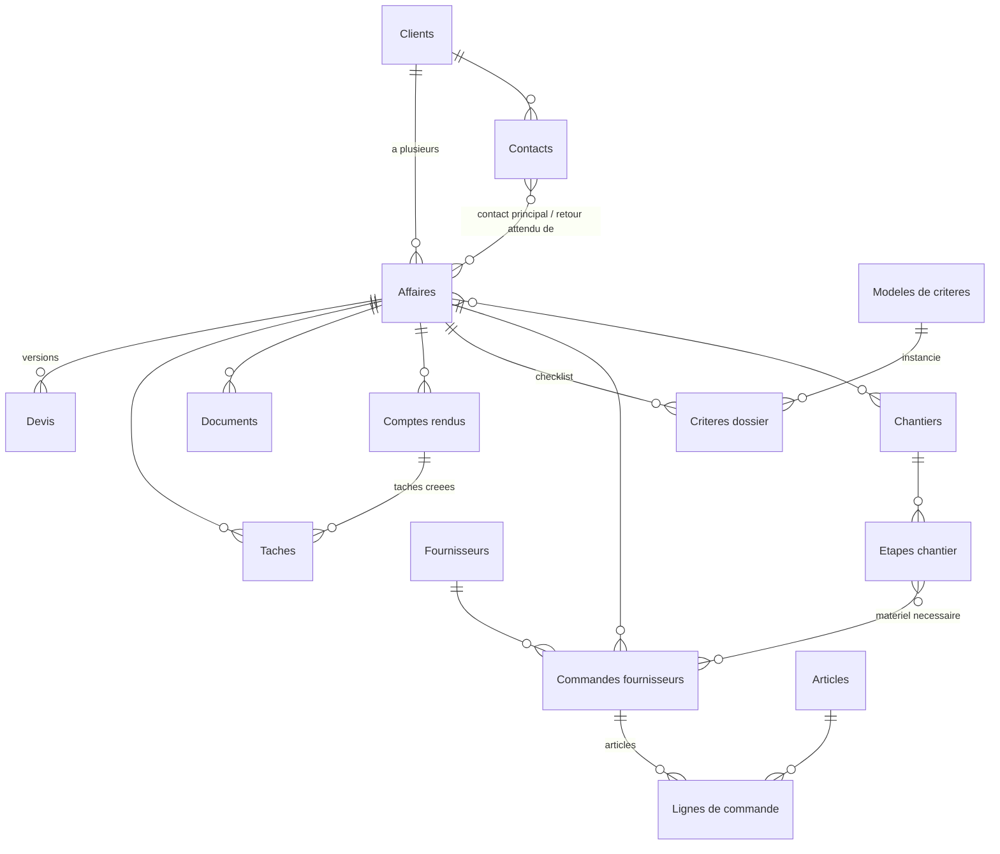

# MEB32 – Gestion commerciale et chantiers (Airtable)

Base Airtable : `appdLfACDzwzveC6H` (nom actuel : « Suivi Commandes et Chantiers - Cédric »).
**À renommer à la main** en « MEB32 – Gestion commerciale et chantiers » : l'API ne permet pas de renommer une base.

Légende utilisée dans ce document :
- ✅ **en place et testé**
- 🟡 **en place, mais vous devez agir** (activer, coller un script)
- ⏳ **prévu, non opérationnel**

---

## 1. État des lieux (avant intervention, 21/11/2026)

| Élément existant | Constat | Décision |
|---|---|---|
| Table Clients (2 enr.) | 1 client test + 1 client « Seyres » | Conservée, enrichie (type, CP, commune, notes, liens Affaires/Contacts) |
| Table Fournisseurs (128 enr.) | **Vraies données** (contacts, délais de commande) | Conservée intacte ; le délai sert au calcul « Commander au plus tard » |
| Table Articles (1 enr. test) | Catalogue article / fournisseur | Conservée, liée aux lignes de commande |
| Table Chantiers (4 enr. test) | Dates, statut calculé, automatisations quotidiennes | Conservée, liée à Affaires et Étapes chantier |
| Table « Commandes clients » (1 enr. test) | Contient en réalité des commandes fournisseurs | **Renommée « Commandes fournisseurs »**, champs date renommés (prévue / réelle) |
| Table « Tâches & Articles » (vide) | Tâches de chantier | **Renommée « Tâches »**, enrichie (responsable, état, urgent, demi-journée, commentaire) |
| Interface « Tableau de bord de Cédric » | 2 tableaux de bord + 5 formulaires | Conservée telle quelle (non supprimée) |
| 7 automatisations actives | 2 avaient une **date figée au 08/07/2026** (cases Commander / Reçue) | 🟡 Corrigées en brouillon (date du jour) : cliquer « Update » pour publier |

Rien n'a été supprimé. Sauvegarde complète (schéma + 136 enregistrements) faite avant modification, dans le dossier de travail de la session (non versionnée, car elle contient les contacts fournisseurs).

## 2. Schéma des tables

Structure complète (champs, types, choix, formules) : [`schema-airtable.json`](schema-airtable.json).

## 3. Champs, statuts et règles

### Affaire : trois notions séparées
- **Statut commercial** : `1. Demande reçue` · `2. RDV / visite` · `3. Étude & chiffrage` · `4. Devis envoyé` · `5. Négociation / modification` · `6. Signé – dossier à compléter` · `7. Prêt à transmettre` · `8. Transmis à Cédric` · `9. Pris en charge par Cédric` · `Reporté` · `Perdu` · `Abandonné`.
- **Prochaine action** + détail + échéance : Organiser RDV, Préparer / Modifier devis, Organiser présentation devis, Relancer, Compléter dossier, Transmettre à Cédric…
- **En attente de** (Personne / Client / OP-Intégrateur / Fournisseur / Interne) + détail + « Retour attendu de » (contacts) + « Relancer le ».
- **Priorité Thibaud** (formule) : 1 Bloqué · 2 Action due · 3 Relance due · 4 Attente tiers · 5 Planifié · 6 Reporté.

Exemple Tachousin (saisi) : statut `4. Devis envoyé`, prochaine action `Organiser présentation devis`, en attente de `OP / Intégrateur`, avec le détail « Retour de Mathieu Pagnac ».

### Anti-doublon
- ✅ « Clé anti-doublon » (client + site + code postal) et page « Doublons possibles ».
- ✅ Script `04-nouvelle-affaire.js` : alerte quand une affaire active existe pour le même client et le même site, code postal ou commune. Testé. 🟡 L'automatisation en place crée la tâche ; pour l'alerte, collez le script.

### Devis (Batigest non modifié)
Une ligne par version : référence, version, date, montant HT, date d'envoi, état, PDF, devis signé, date de signature. La **version acceptée** est la seule cochée « Version acceptée ». Les anciennes passent en `Remplacé (archive)`. Le champ « Signé valide » vaut 1 seulement si la case est cochée **et** qu'un PDF signé est joint.

### Complétude et blocage de la transmission
- Catalogue « Modèles de critères » : 29 critères (socle commun + par famille d'équipements), modifiable.
- Le contrôle copie dans l'affaire les critères qui s'appliquent à ses « Familles d'équipements ».
- Statuts d'un critère :
  - `Manquant`, `Présent – à confirmer` ou `Ambigu / contradictoire` : proposés par la machine ou l'IA ;
  - `Validé` ou `Non applicable` : **décision humaine**, avec « Validé par ».
- **Conditions manquantes** (formule) : la transmission est possible seulement si elle est vide, c'est-à-dire :
  1. un devis signé valide ;
  2. une date de travaux fixée **et** confirmée ;
  3. tous les critères obligatoires Validés ou Non applicables ;
  4. la case « Documents accessibles » cochée.
- Un texte d'IA ne suffit jamais : seul le statut des critères compte.

### Commandes fournisseurs
- La situation est calculée à partir des lignes : `À commander` → `Commandée – attendue` → `Reçue partiellement` → `Reçue totalement`.
- « Commander au plus tard » = date des travaux − délai fournisseur − 7 jours.
- Alertes : commande urgente, livraison en retard, livraison trop proche des travaux (moins de 3 jours), date de livraison inconnue, case « Bloque le chantier ».
- Étapes chantier : « Matériel » (tout reçu / attendu à temps / risque) et « Écart (jours) » entre le prévu et le réel.
- Aucun envoi automatique de commande aux fournisseurs.

## 4. Interfaces (publiées)

| Interface | Pages |
|---|---|
| **Thibaud – Commercial** | Mes affaires (onglets : À agir, Devis à faire/modifier, Présentations à organiser, Relances, Retours attendus, Bloqués, Signés à préparer pour Cédric) · Pipeline (kanban) · Doublons possibles · **Revue des tâches** (élément sur mesure) |
| **Cédric – Commandes et chantiers** | Dossiers transmis (Nouveaux / Pris en charge) · Commandes fournisseurs (À commander, Attendues, Partielles, Reçues, Retards et blocages) · Réceptions (lignes) · Préparation des chantiers · Mes tâches |
| **Vue globale MEB32** | Indicateurs affaires, commandes et tâches · kanban par statut · alertes commandes · tâches par responsable |
| Fiche « Affaire » (partagée) | Client et projet · suivi commercial · devis · tâches · contrôle et transmission · **questionnaire** (critères) · comptes rendus et documents · commandes |
| Formulaires autonomes (à publier) | « Nouvelle demande client » · « Compte rendu de RDV » (saisie manuelle) |

L'interface existante « Tableau de bord de Cédric » est conservée, mais elle s'appuie sur les anciens champs.

**Revue des tâches.** L'interface native enregistre chaque clic aussitôt ; elle ne permet pas de « valider ses réponses » en une fois. D'où l'élément sur mesure [`custom-elements/revue-taches.tsx`](custom-elements/revue-taches.tsx) :
- boutons Fait / Urgent / Demi-journée, cumulables ;
- commentaire par tâche ;
- section « À traiter en priorité » (urgent, demi-journée, en retard, aujourd'hui) ;
- filtre par responsable ;
- rien n'est écrit avant « Valider mes réponses ».

Aucune tâche n'est placée dans Google Agenda. Compilation et installation réussies ; l'affichage est **à vérifier par vous** (je n'ai pas pu ouvrir l'interface dans un navigateur).

## 5. Automatisations (créées éteintes : à activer dans Airtable)

| Nom | Déclencheur | État |
|---|---|---|
| Nouvelle affaire → tâche « prochaine action » | Affaire avec nom + client et sans tâche | 🟡 Complète, à activer |
| Devis signé → lancer le contrôle | Devis « Signé valide » = 1 | 🟡 Complète, à activer |
| Contrôle du dossier | « Lancer le contrôle » cochée | 🟡 **Coller** `scripts/01-controle-dossier.js` |
| Résultat du contrôle → e-mail à Thibaud | « Dernier contrôle » modifié | 🟡 Complète (e-mail intégré à Airtable), à activer |
| Demande de transmission à Cédric | « Demande de transmission » cochée | 🟡 **Coller** `scripts/02-transmission-cedric.js`. Sans le script, l'action provisoire **refuse** toute transmission |
| Garde-fou « Transmis » manuel | Statut 8 sans date de transmission | 🟡 Complète, à activer |
| Prise en charge par Cédric → horodatage | Statut 9 sans date | 🟡 Complète, à activer |
| Compte rendu → création des tâches | « Créer les tâches » cochée | 🟡 **Coller** `scripts/03-compte-rendu-taches.js` |
| Tâche faite → date et état | « Fait » cochée sans date | 🟡 Complète, à activer |
| Commander / Reçue → statut + date (existantes) | Cases cochées | 🟡 Date figée corrigée en brouillon : cliquer « Update » |

**Pourquoi coller des scripts à la main ?** Le connecteur Airtable refuse de créer une action « Exécuter un script » (`INVALID_PERMISSIONS`).

Pour chaque script :
1. Ouvrir l'automatisation.
2. Remplacer l'action provisoire par « Exécuter un script ».
3. Coller le fichier.
4. Ajouter la variable d'entrée `recordId` = ID de l'enregistrement déclencheur.
5. Tester, puis activer.

## 6. Connexions et limites

| Besoin | Situation réelle |
|---|---|
| Lecture des devis PDF par l'IA | ✅ Faite dans la session Claude via l'API Airtable (lecture du PDF signé de démonstration). ⏳ Rien dans Airtable n'en fait autant : l'IA d'Airtable ne lit pas les PDF joints. Pour automatiser, il faudrait un script qui appelle une API d'IA avec une clé (décision et coût à prévoir) |
| Google Agenda → comptes rendus | Agenda lisible depuis la session Claude (vérifié en lecture seule). ⏳ Aucun compte Google connecté à Airtable : pas d'import automatique. Disponible dès maintenant : formulaire « Compte rendu de RDV », ou traitement par Claude avec l'ID d'événement comme clé anti-doublon |
| E-mail du résultat de contrôle | 🟡 Possible avec l'action e-mail intégrée d'Airtable (sans Gmail). Configurée, non encore envoyée : elle part quand l'automatisation est activée |
| Notification dans ChatGPT | ❌ Aucune connexion ChatGPT disponible. Non réalisable ici |
| Batigest | Non connecté, non modifié. Saisie de la référence + PDF |
| OneDrive | Champ lien « Dossier OneDrive » ; aucun accès OneDrive depuis cette session |
| Todoist | Non utilisé (vos événements d'agenda contiennent encore des liens Todoist) |
| Renommer la base | ❌ Impossible par l'API : à faire à la main |

## 7. Ordre de mise en place recommandé

1. Renommer la base. Publier les deux formulaires.
2. Activer : nouvelle affaire, tâche faite, garde-fou, prise en charge. Publier la correction des deux automatisations « Commander / Reçue ».
3. Coller les scripts 02 (transmission) et 01 (contrôle), tester sur le dossier DEMO, puis activer avec « Devis signé → contrôle » et « Résultat → e-mail ».
4. Coller le script 03 (comptes rendus).
5. Compléter l'affaire Tachousin. Saisir les affaires en cours.
6. Inviter Cédric sur l'interface « Cédric – Commandes et chantiers ».
7. Plus tard : connecter Google Agenda et décider de la lecture automatique des PDF par IA.

Une fois le système en route, les tables d'essai (enregistrements DEMO / TEST) peuvent être supprimées.
